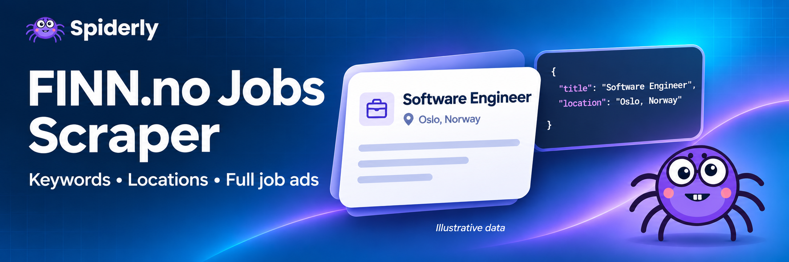

[](https://apify.com/spiderly/finn-no-job-scraper-fast-multi-keyword)

# Finn.no Job Scraper - Fast, Multi-Keyword

Scrape job ads from **Finn.no**, Norway's largest job board, in seconds. Search several keywords in one run, filter by county or city by name, and get full descriptions, deadlines, employers and coordinates as clean JSON, CSV or Excel.

Built on plain HTTP (no browser), so it is fast and cheap: **200 jobs with full descriptions in about 16 seconds.**

## What can Finn.no Job Scraper do?

| 📦 What you can extract | ⚙️ Features |
|---|---|
| 💼 Job title, employer, employer website | 🔎 **Multiple keywords in one run**, duplicates removed |
| 📍 Location, all work locations, latitude/longitude | 🗺️ Location by **name** (Rogaland, Haugesund, Oslo…) or Finn code |
| 📅 Published date and application deadline | 🔗 Or paste any **Finn search URL** with your own filters |
| 🧾 Employment type (full-time, part-time, temporary) | ⚡ Parallel fetching: 200 jobs in ~16 s |
| 📝 Full description as **plain text and HTML** | 🧮 Search rank of every job, number of positions |
| 🖼️ Employer logo, direct ad link | ⬇️ Export to JSON, CSV, Excel, XML; API, webhooks, schedules |

Use it for job alerts, labour-market research, recruitment lead generation, salary and skills trend analysis, or to feed your own job board or CRM.

## Cost

See the Pricing tab and your run’s usage details for current Apify charges.

## How do I use it?

1. Create a free Apify account and open the Actor.
2. Add one or more **keywords** (for example `utvikler`, `developer`, `sykepleier`).
3. Optionally set a **location** such as `Rogaland`, `Haugesund` or `Oslo`.
4. Set **Maximum number of jobs** and click **Start**.
5. Download the dataset as JSON, CSV, Excel or XML, or read it through the API.

## Input

| Field | Type | What it does |
|---|---|---|
| `keywords` | list of text | One search per keyword. Results are merged and de-duplicated. |
| `keyword` | text | Shortcut for a single keyword. |
| `location` | text | County or municipality name, or a Finn code like `1.20001.20012`. Applied to every keyword. |
| `startUrls` | list of URLs | Any Finn job search URL (filters included). Use instead of, or together with, keywords. |
| `maxJobs` | number | Total jobs to save across all searches (default 50, up to 5000). |
| `maxPages` | number | Safety limit on result pages per search (about 50 jobs per page). |
| `includeDetails` | true/false | Adds full description, employer website, employment type and exact deadline. Turn off for the fastest basic listing. |
| `proxyConfiguration` | object | Optional. Works without a proxy. |

**Example input**

```json
{
  "keywords": ["utvikler", "developer", "backend"],
  "location": "Rogaland",
  "maxJobs": 200,
  "includeDetails": true
}
```

## Output

Every job is one dataset item. Example (shortened):

```json
{
  "id": "478710684",
  "url": "https://www.finn.no/job/ad/478710684",
  "title": "Software Developer",
  "company": "SmartDok AS",
  "companyUrl": "https://smartdok.no/",
  "location": "Oslo - Ullern",
  "allLocations": ["Tromsø", "Oslo", "Alta"],
  "published": "2026-10-14T11:14:23.000Z",
  "deadline": "2026-11-06",
  "employmentType": "FULL_TIME",
  "positions": 1,
  "latitude": 69.65175,
  "longitude": 18.95629,
  "description": "Vi søker en erfaren og teknisk sterk seniorutvikler ...",
  "descriptionHtml": "<p>Vi søker en erfaren ...</p>",
  "logo": "https://images.finncdn.no/dynamic/default/item/478710684/...",
  "rank": 1,
  "searchUrl": "https://www.finn.no/job/search?q=utvikler&location=1.20001.20061",
  "scrapedAt": "2026-11-01T11:30:20.000Z"
}
```

Some fields are empty when the employer did not provide them (for example `deadline` for ads without an application deadline).

## Tips

- **Several keywords, one run:** Finn's search is fuzzy, so keywords overlap a lot. The Actor removes duplicate jobs, so the final count can be lower than `maxJobs`.
- **Speed:** the Actor is tuned for 4 GB of memory. Smaller memory works but runs slower.
- **Fresh jobs only:** schedule the Actor daily and compare `id` values to spot new ads.
- **Your own filters:** build a search on finn.no (occupation, industry, sector, remote), copy the URL into `startUrls`.

## Use cases

- 🔔 **Job alerts:** run daily for your keywords and send new jobs to Slack, email or Google Sheets.
- 📊 **Market research:** count jobs per employer, location or technology over time.
- 🧲 **Recruitment leads:** find companies that are hiring and their websites.
- 🧠 **AI and RAG:** the plain-text description is ready for LLM pipelines.

## FAQ

**Is it legal to scrape Finn.no?**
The Actor collects publicly visible job ads only. Public data can still contain personal data (for example contact names), so make sure you have a legitimate reason to use it, follow GDPR, and respect Finn.no's terms of use.

**How many jobs can I get?**
As many as Finn shows publicly for your search. A single search returns up to about 24 pages (around 1,200 jobs); use several keywords, locations or start URLs to go wider.

**Do I need a proxy?**
Not normally. Enable Apify Proxy only if Finn starts blocking your requests.

**Can I search in English and Norwegian at once?**
Yes, add both as keywords, for example `utvikler` and `developer`.

**Can I use it from code?**
Yes. Use the Apify API, the JavaScript or Python client, webhooks, or an MCP client.

**Something is wrong or missing.**
Open an issue on the Actor's Issues tab with a run link. Finn.no can change its pages from time to time, so a link to the failing run helps a lot.

## Disclaimer

This Actor is not affiliated with or endorsed by FINN.no. Product names are used only to describe what the Actor works with.
