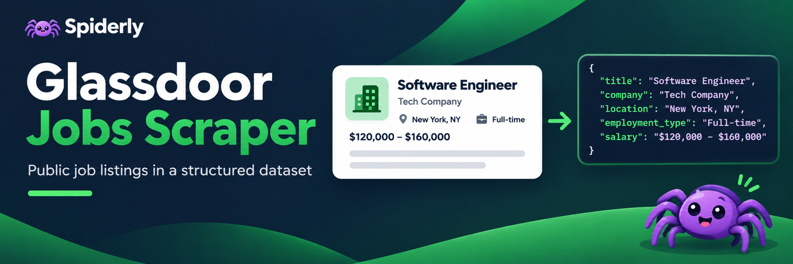

*The banner shows illustrative data.*

# Glassdoor Jobs Scraper

Collect public job cards from US Glassdoor search pages into an Apify dataset. Each row contains a listing link, title, employer, location, and any salary, rating or preview text shown on the card.

## Quick start

1. Run a job search on www.glassdoor.com with the filters you want.
2. Paste the results page URL into **Glassdoor search URLs**.
3. Set the maximum number of jobs and start the Actor. Export the dataset as JSON, CSV, or Excel.

```json
{
  "searchUrls": [
    {
      "url": "https://www.glassdoor.com/Job/Software-Engineer-New-York-SRCH_KO0%2C17_IL.18%2C26_IC1132348.htm"
    }
  ],
  "maxItems": 5,
  "maxPages": 1
}
```

Supply up to five search URLs. The result limit applies across all searches and duplicate listing IDs are removed. Each search starts with one batch. A higher batch limit lets the Actor click **Show more jobs** when it is available.

## Import results from your browser

If the live run reports an access block, open the public search in your browser. Load the job cards you want, then use **Save page as** and choose **HTML only**. Open the HTML file in a text editor and paste its contents into **Saved search HTML**. Enter the original search URL in **Glassdoor search URLs** and run the Actor.

Import mode reads the cards present in the saved file. It makes no requests to Glassdoor, ignores the batch limit, and applies the same unique job limit as a live run. Save a public results page from a signed-out browser so the Actor input contains only public page content.

## Sample output

Selected fields from a public New York search card. Job listings and their displayed data change over time.

```json
{
  "jobId": "1010219783710",
  "title": "Junior Software Engineer",
  "company": "SOCOTEC Group",
  "companyRating": 3.2,
  "location": "New York, NY",
  "jobUrl": "https://www.glassdoor.com/job-listing/junior-software-engineer-socotec-group-JV_IC1132348_KO0,24_KE25,38.htm?jl=1010219783710",
  "easyApplyBadge": true,
  "salaryRaw": "$110K - $140K (Employer provided)",
  "salaryMin": 110000,
  "salaryMax": 140000,
  "salaryCurrency": "USD",
  "salaryPeriod": null,
  "salarySource": "employer"
}
```

The dataset also includes `snippet` and `sourceUrl`. Missing optional fields use `null`. The pay period is filled only when the card states it. A single advertised salary uses the same value for both bounds. `easyApplyBadge` records whether the card shows that badge, and `jobUrl` opens the Glassdoor listing.

## Run summary

Open **SUMMARY** in the key-value store for counts by search and any errors. The Actor stops collecting from a search if Glassdoor restricts access. A run fails if it collects zero rows. Results are limited to public search cards and contain short previews when available.
