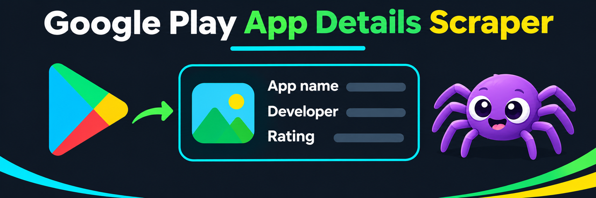

# Google Play App Details Scraper

Look up public Google Play listings by Android package ID or store URL. Export app titles, developer names, categories, ratings, descriptions, download badges, and listed prices to JSON, CSV, or Excel.

## Quick start

Enter up to 50 IDs or URLs in **Apps**, choose the storefront country and language, and start the Actor. Repeated package IDs are looked up once. The default sample uses three apps from the US storefront.

```json
{
  "apps": ["com.spotify.music", "com.duolingo", "org.wikipedia"],
  "language": "en",
  "country": "US"
}
```

## Sample output

Selected fields from the Spotify listing in the US sample.

```json
{
  "appId": "com.spotify.music",
  "title": "Spotify: Music and Podcasts",
  "developer": "Spotify AB",
  "category": "MUSIC_AND_AUDIO",
  "contentRating": "Teen",
  "downloads": "1B+",
  "price": 0,
  "currency": "USD",
  "country": "US",
  "language": "en"
}
```

Ratings and prices can change by storefront and over time. The price is the listing offer, and the downloads field is a displayed threshold. The download badge and update date are read from English labels when present. Missing optional fields are returned as `null`.

## Run summary

The default dataset contains one row per successful app lookup. Open **SUMMARY** in the key-value store for requested and successful app counts and any failed IDs. A run with no successful lookups fails.
