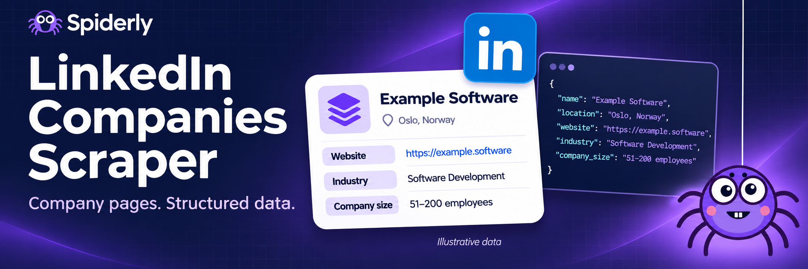

[](https://apify.com/spiderly/linkedin-companies-scraper)

## What does LinkedIn Companies Scraper do?

Collect structured company information from public [LinkedIn company pages](https://www.linkedin.com/). Supply company URLs, exact slugs or numeric LinkedIn company IDs, run a bulk lookup, then export the results as JSON, CSV or Excel. **No LinkedIn login, cookies or subscription required.**

**This is direct company-page lookup. Keyword company discovery and people profiles are not included.**

Use it to enrich a company list, prepare business research, organize company websites and industries, or monitor public company information over time.

## What does it extract?

When available on the public overview page:

- Company name, tagline, LinkedIn URL, slug and company ID.
- Description, industry, company type and founding year.
- Company website, with LinkedIn's public redirect unwrapped.
- Public business phone number, when exposed.
- Company-size range and the separate employees-on-LinkedIn count.
- Followers, specialties, headquarters and public location addresses.
- Company logo, cover image and public jobs search link.

Each result includes its original input, normalized request URL, timestamp, attempt count and lookup status. Missing information stays `null` or an empty list. Counts and addresses reflect what LinkedIn exposes, not independently verified company records. Banner data is illustrative.

| Field | Type | Meaning |
| --- | --- | --- |
| `name`, `companyId`, `linkedinUrl` | text or null | Company identity and source page. |
| `description`, `tagline`, `industry` | text or null | Public company overview fields. |
| `websiteUrl` | text or null | Public website link, with LinkedIn redirect unwrapped. |
| `employeeCount`, `followersCount` | number or null | Public LinkedIn counts; not verified payroll data. |
| `employeeCountRange` | object or null | Parsed company-size range; open-ended upper bound is null. |
| `headquarter`, `locations` | object / list | Public structured headquarters and office address text. |
| `status`, `reason` | text / text or null | Whether the company was found and why a lookup failed. |

## Start with a company list

1. Paste company page URLs, slugs or IDs into **Company URLs, slugs or IDs**.
2. Start with a small list to check access and output.
3. If LinkedIn restricts requests, configure an appropriate proxy or lower the request rate.
4. Click **Start** and inspect the Companies dataset.
5. Export the data or connect it to your workflow through the Apify API.

```json
{
  "companies": [
    "https://www.linkedin.com/company/microsoft/",
    "/company/cognitedata/",
    "apify"
  ],
  "maxConcurrency": 3,
  "maxRequestsPerMinute": 60,
  "maxRetries": 2,
  "proxyConfiguration": { "useApifyProxy": false }
}
```

`microsoft` means the exact `/company/microsoft/` page. It is not a search for every company whose name contains Microsoft. A numeric ID is requested as `/company/ID/` and follows LinkedIn's redirect to the company page when available. Numeric IDs can redirect to sign-in instead; use the company slug or full URL for the most dependable public lookup.

You can also use `startUrls`:

```json
{
  "startUrls": [
    { "url": "https://www.linkedin.com/company/apify/" }
  ]
}
```

Both lists are combined. Up to 5,000 entries are accepted. Exact duplicates after URL normalization are collected once: locale subdomains, tracking parameters, capitalization and trailing slashes are normalized. Different identifiers that redirect to the same company may still produce separate rows so you can retain their input mapping.

## Inputs

| Field | Meaning |
| --- | --- |
| `companies` | Company URLs, `/company/slug` paths, exact slugs or numeric company IDs. |
| `startUrls` | An additional list of company overview URLs, in Apify's URL-list format. |
| `maxConcurrency` | Parallel lookups, 1–10; default 3. |
| `maxRequestsPerMinute` | Rate across all requests, including redirects and retries; default 60. |
| `maxRetries` | Retries after temporary failures; default 2, maximum 5. |
| `requestTimeoutSecs` | Per-request timeout; default 30 seconds. |
| `proxyConfiguration` | Optional Apify or custom proxy. Direct requests are the default. |

Only LinkedIn company overview pages are accepted. Person profiles, arbitrary websites, company posts URLs and broad search terms are rejected. The Actor does not visit a company's external website; it extracts the website link from LinkedIn.

## Output example

These shortened records come from the 7 November 2026 live validation sample. Fields not shown here remain available in the full dataset; counts may change over time. You can download the dataset in JSON, HTML, CSV or Excel.

```json
[
  {
    "input": "https://www.linkedin.com/company/apify/",
    "status": "FOUND",
    "name": "Apify",
    "companyId": "10608457",
    "websiteUrl": "https://apify.com/",
    "industry": "Technology, Information and Internet",
    "employeeCount": 274,
    "employeeCountRange": {
      "start": 201,
      "end": 500
    },
    "followersCount": 47085,
    "foundedYear": 2016,
    "scrapedAt": "2026-11-07T00:06:06.317Z"
  },
  {
    "input": "https://www.linkedin.com/company/cognitedata/",
    "status": "FOUND",
    "name": "Cognite",
    "companyId": "18045548",
    "websiteUrl": "https://www.cognite.com/en",
    "industry": "Software Development",
    "employeeCount": 933,
    "employeeCountRange": {
      "start": 501,
      "end": 1000
    },
    "followersCount": 122124,
    "foundedYear": 2016,
    "scrapedAt": "2026-11-07T00:06:07.178Z"
  }
]
```

Important field details:

- `employeeCount` is the employees-on-LinkedIn value exposed in the public page's structured data. It is not a verified payroll count.
- `employeeCountRange` comes from the company-size label. An open-ended range such as `10,001+` has `end: null`.
- `locations` contains `address`, `addressLines`, `headquarter` and `mapUrl`. Addresses are preserved as public text. Coordinates are not inferred or geocoded.
- `headquarter` is the structured headquarters address when exposed; `headquarters` is LinkedIn's visible headquarters label.
- `tagline` and `phone` are only populated when exposed in supported public fields. `industryId` is currently `null`; this version does not infer an industry code from its name.
- `FOUND` means a company overview was parsed. It does not mean every optional field was available.

## Lookup statuses and failures

| Status | Meaning |
| --- | --- |
| `FOUND` | A public company overview was collected. |
| `NOT_FOUND` | LinkedIn returned HTTP 404 or 410. |
| `BLOCKED` | Access was restricted, rate-limited or redirected to sign-in/verification. |
| `ERROR` | A network failure, server error, unexpected redirect or unsupported page response prevented extraction. |

Failed lookups remain in the dataset with `input`, `requestedUrl`, `status`, `reason`, `httpStatus`, `attempts` and `scrapedAt`, so you can retry them later. An HTTP 200 login page is not reported as a company. If no company profiles are collected, the run fails with an explanation while preserving the dataset.

The key-value store's `SUMMARY` record counts found, missing, blocked and failed lookups. Some failures in a batch do not discard the companies that succeeded.

## Same-input comparison with Bebity

On **7 November 2026 (Europe/Oslo)**, we ran this Actor and [Bebity's LinkedIn Companies & Profiles scraper](https://apify.com/bebity/linkedin-premium-actor) against the same four direct company URLs: Microsoft, Cognite, Apify and Cisco. Both runs used 512 MB. Spiderly used direct requests with no proxy; Bebity used its default internal configuration. Both were invoked through Apify MCP during the same session. The final Spiderly verification followed the reference batch by about nine minutes, so this was not a simultaneous controlled speed benchmark.

| Measured result | Spiderly | Bebity |
| --- | --- | --- |
| Company URLs submitted | 4 | 4 |
| Company profiles returned with data | 4 | 0 |
| Dataset rows | 4 | 4 |
| Failed lookup rows | 0 | 4: `NOT_FOUND`, reason `UNREACHABLE` |
| Process status | `SUCCEEDED` | `SUCCEEDED` |
| Run time | 6.556 seconds | 18.498 seconds |
| Compute units | 0.00091056 CU | 0.00256917 CU |
| Observed run charge | Console showed $0.000 rounded (less than $0.001) | $0.00005: one start event, zero company events |

Charges use different models: Spiderly incurs normal platform usage, while Bebity bills its event price and does not separately charge platform usage. The Console rounds Spiderly's tiny run charge and excludes ongoing timed storage, so it is not presented as an exact zero. There is no valid cost-per-success comparison when the reference returns no company profiles.

**Four rows do not necessarily mean four company profiles.** In this sample, every Bebity row was an unsuccessful lookup. We also checked its `/company/microsoft` path format, which returned `UNREACHABLE`, and a `Cognite` company-name search, which produced no profile.

This is a small availability test, not proof of general superiority. Because the reference returned no company data, we cannot establish field-level accuracy, equal feature coverage or a fair cost per successful company. Bebity documents additional capabilities—including keyword company search, people profiles, coordinates, industry IDs and verification data—that this public-page Actor does not claim to reproduce. Do not infer that missing fields agree just because both runs completed.

[Spiderly test run](https://console.apify.com/actors/runs/r1m1E9StcBvdfwWlo) · [Bebity test run](https://console.apify.com/actors/runs/i2Sn0aoIuKCWL20BX). These run links may require access to the account that ran the tests. Runtime and counts describe this sample only; they are not guarantees.

## What is included in this version?

This Actor focuses on **bulk company-page lookup**. It does not currently include broad keyword company discovery, LinkedIn people profiles, employee lists, Sales Navigator, company posts, private contact enrichment or authenticated-only data. It does not claim full feature parity with a combined companies-and-people scraper.

Verification badges, active status, arbitrary company hashtags and latitude/longitude are not guessed. Public-page availability can change, and some pages may require a proxy or remain inaccessible.

## Automation and costs

Use Apify's API, schedules, webhooks and integrations to connect your company data to other tools. Read the dataset for company results and the `SUMMARY` record for batch health. Always keep your API token private.

The Actor has no added developer fee at publication; normal Apify platform usage still applies. The Actor uses HTTP requests and parses public HTML and structured data. Cost depends on your Apify plan, proxy configuration, timeouts, redirects and retries. Enabling a proxy can add charges. Start with a small test; no fixed price or speed is guaranteed.

## Troubleshooting

**I get blocked results.** Lower the request rate and concurrency, or use a proxy configured for your Apify account. The Actor does not solve verification challenges or use your personal LinkedIn session.

**My company name is rejected.** Use its exact LinkedIn company URL or slug. A business name such as `Example Software AS` is not necessarily its LinkedIn slug.

**Some values are empty.** The public company page may not include them. No value is invented to fill a missing field. Follower counts use the visible company header or the company page metadata; compact labels such as 1.2M are rounded values from LinkedIn.

**A run failed but has rows.** Check their statuses. A batch with no successfully parsed company pages is deliberately marked failed so an empty or blocked scrape is visible.

Report issues with a run link and an affected company URL, without credentials.

---

Built by **Spiderly**. Independently developed and not affiliated with or endorsed by LinkedIn. LinkedIn names and marks belong to their owner. Use collected data in accordance with applicable rules and the source site's terms.
