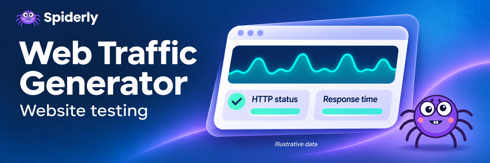

## What does Web Traffic Generator do?

Send **controlled HTTP visits** to websites you own or have permission to test. See which URLs respond, check redirects and export timing and error results from a single run. Use it for a quick check after a deployment, a scheduled uptime check, or a repeatable comparison of endpoints from the same environment.

Each request carries the `SpiderlySynthetic/1.0` user agent and an `X-Spiderly-Synthetic` label. You can use these values to identify test requests in your server logs. Desktop, mobile and tablet are request labels. Browser rendering, browser device emulation and JavaScript analytics events are outside the scope of HTTP visits.

## How to run a website test

1. Enter one to ten website URLs. The starter example uses `https://example.com/`.
2. Choose the total visit count. Allow at least one visit per distinct URL. The Actor supports up to 50 visits and five concurrent visits, with a configurable gap between HTTP request starts.
3. Run the Actor and open **Individual visits** for the rows or **Run summary** for status counts and timing. Export the dataset as JSON, CSV or Excel, or use the Apify API.

For recurring checks, save the input as an Apify task and set a schedule. Start with a few visits and adjust request spacing to suit your website.

## Example input

```json
{
  "startUrls": [{ "url": "https://example.com/" }],
  "visitCount": 3,
  "concurrency": 2,
  "intervalMs": 500,
  "timeoutSecs": 15,
  "requestLabels": ["desktop", "mobile", "tablet"],
  "discoverLinks": false
}
```

Enable **Discover site links** to use remaining visits on links found in HTML on the same origin. Discovery checks `robots.txt`. If the rules cannot be read, discovery is skipped for that origin. The Actor visits the supplied URLs first and then uses the remaining budget on discovered URLs or repeats of the supplied URLs.

Targets must use public IPv4 DNS and standard HTTP or HTTPS ports. Provide URLs without credentials or query strings. Redirects can follow up to three hops within the original origin, including its scheme. To test the HTTPS endpoint directly, enter its HTTPS URL. Response bodies are sampled up to 256 KiB for bounded processing and excluded from the dataset.

## Example output

Two shortened rows from the example run. Times reflect that run and can vary by location and server conditions.

```json
[
  { "visit": 1, "url": "https://example.com/", "requestLabel": "desktop", "statusCode": 200, "success": true, "responseMs": 147, "durationMs": 182 },
  { "visit": 2, "url": "https://example.com/", "requestLabel": "mobile", "statusCode": 200, "success": true, "responseMs": 116, "durationMs": 458 }
]
```

- **`responseMs`** measures the final HTTP request through receipt of response headers, including connection setup. The visit summary reports median and p95 for successful responses using the nearest-rank method.
- **`durationMs`** measures the full visit, including DNS, any wait for the next request slot, redirects and the bounded response read.
- **`statusCode`, `success`, `error`** show the last HTTP status, whether the visit completed with a 2xx response, and the failure code when applicable. The Actor records failed visits as rows, so a completed run can report a site outage.

## Cost and support

Check the Pricing tab for current rates and the run’s usage details for actual charges. Visit count, request spacing, response time and timeouts affect run duration. For questions or unexpected results, open the Actor’s Issues tab and include a run link and the error code.
